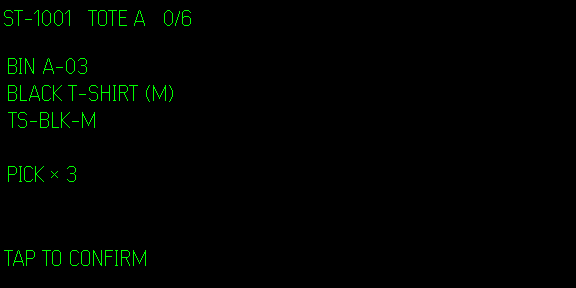
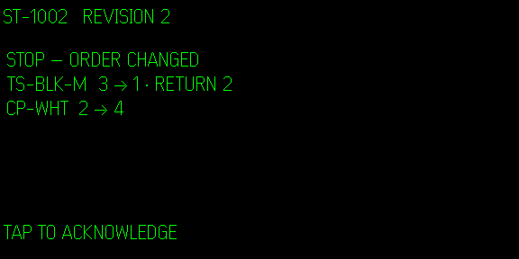
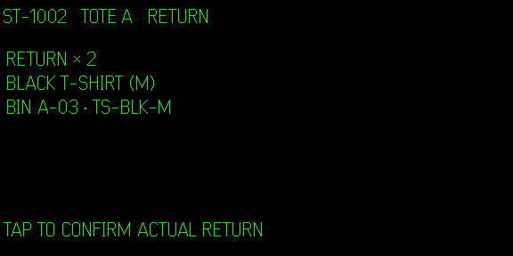
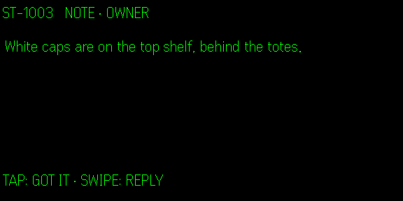
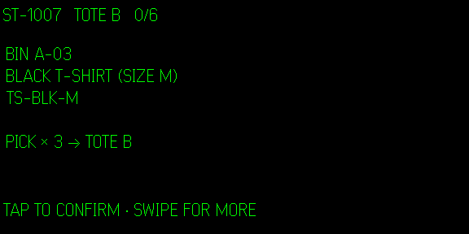
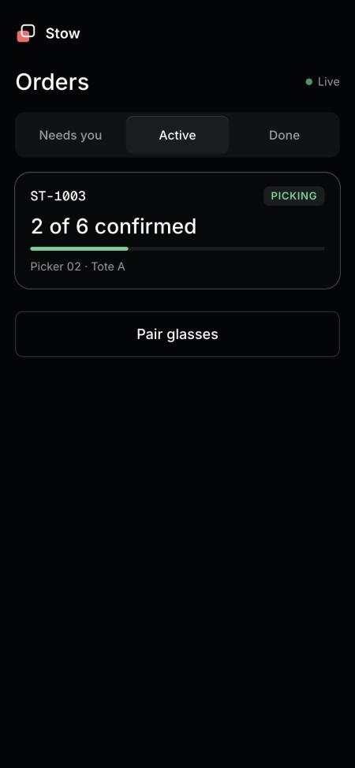
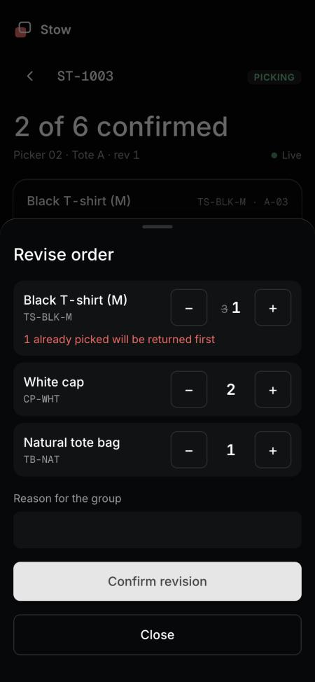
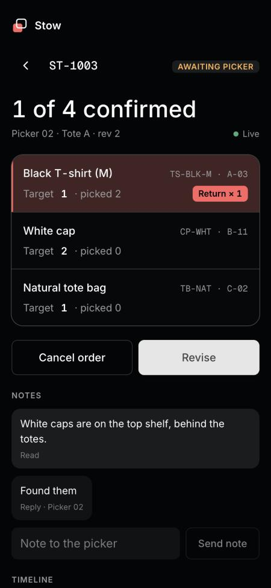

# Stow

[](https://github.com/gsoffmarket/stow/actions/workflows/ci.yml)
[](LICENSE)

**Your work group's orders on your glasses, answered without touching your phone.**

Stow connects a Telegram work group to Even G2 smart glasses. Orders posted in the group become one-item picking instructions on the glasses. The picker confirms what they actually put in the tote with a tap, and the order's status message in the group updates as they go. When the coordinator changes an order mid-pick, Stow works out what has to go back before anything else, and the picker can answer the group in one tap.

<p>
  
  
</p>

## The problem

Small stockrooms and e-commerce teams often run fulfilment in a Telegram group: orders, changes and "where are the white caps?" all arrive there. The person picking has to stop, take out a phone, scroll the group and type back. When an order changes halfway through, what they read five minutes ago is already wrong, and nobody knows whether the extra items already in the tote were accounted for.

Stow is for the picker with full hands and for the coordinator who wants to keep using Telegram instead of learning a warehouse system.

## How it works

1. An owner messages the bot `/setup Lagos stockroom`, adds it to the work group with `/stow_connect`, and invites pickers with one-time links. There are no passwords: a person is their Telegram account.
2. A picker opens Stow on the glasses, which show a pairing code, and approves it in the Stow Mini App inside Telegram.
3. A coordinator posts `/order` with one `SKU x QTY` per line. The bot answers with a status message it keeps editing.
4. The glasses show one instruction at a time: bin, item, SKU and `PICK × N`. A tap confirms it.
5. If the coordinator revises the order, cancels it, or answers a shortage, the glasses stop the picker, show exactly what changed, and ask for any returns first.
6. Notes travel both ways: a coordinator's reply to the status message appears on the glasses, and the picker answers with a quick reply that the bot posts under the order.

The core is a pure order engine that keeps two numbers per line: what the coordinator currently wants (`requested`) and what the picker has confirmed (`picked`). It never clamps one to the other. If a target drops below what is already in the tote, the difference becomes a return the picker must do first. Every command carries the revision and version the screen showed, so a tap on an out-of-date screen is refused rather than applied to a new plan.

**Stack:** TypeScript throughout. Node 24 runs the API directly from TypeScript (Fastify, Zod, `pg`). PostgreSQL 18. The glasses app uses the official Even Hub SDK. The Telegram Mini App uses React 19, Tailwind 4 and Motion. Telegram goes through the Bot API.

**Design decisions:**
- **One transaction per change.** State, event, idempotency record and Telegram outbox row commit together. Telegram is never on the critical path of saving physical work.
- **Honest delivery.** A first message whose send outcome is unknown is marked uncertain and never blindly repeated. The glasses say "Telegram: pending" until Telegram accepts the message.
- **Explicit commands only.** Plain chat is never processed. Changes are previewed with Confirm and Discard buttons, and a confirm after the order moved is refused.
- **Tenancy in the schema.** Every row references its parent through `(workspace_id, id)`, so cross-workspace links fail at insert time.

See [docs/architecture.md](docs/architecture.md) for the codemap, invariants and decisions, and [docs/demo.md](docs/demo.md) for the demo run sheet.

## What works today

| Area | What it does |
|---|---|
| **Telegram** | `/setup`, `/stow_connect`, invite links, `/order`; `/revise`, `/cancel` and `/resolve` with preview buttons; shortage messages with Resume / Reduce / Cancel; one live status message per order; notes and picker replies |
| **Glasses** | Pick, return, partial quantity, batches of 2–5 orders in separate totes, revision and decision acknowledgements, report a problem, pause, coordinator notes, quick replies, a Saved screen with the Telegram delivery state, pairing |
| **Mini App** | Telegram sign-in, glasses pairing, and a coordinator console with orders, detail, revise, cancel, resolve, notes and timeline |
| **Engine** | Batch planning across totes in walking order, revisions that never overwrite picked work, mandatory returns, cancellation with full return, one open problem per order, idempotent commands, stale-command rejection |

**Verified runs**, all in Even Hub simulator 0.9.5 against a real Postgres database:
- **Pick to complete:** start, three picks, review, complete. Six events committed.
- **Change mid-pick:** pick 3 shirts, revise to 1, acknowledge, return 2, report a shortage from More, coordinator reduces, acknowledge, pick, complete. Twelve events in that order.
- **Pairing:** the glasses showed a code, it was approved in the Mini App, and the glasses loaded that picker's work.
- **Notes and replies:** a coordinator note on the glasses, then "Found them" sent from the quick replies.
- **Fewer than asked:** a partial quantity of 2 of 3.
- **Console revision:** a revision from the Mini App reached the glasses as "STOP — ORDER CHANGED".
- **Batch of two:** started from More, picked in walking order across totes A and B (A, B, A, B, A), each tote reviewed and completed. Twelve events in that order.

**248 automated tests** pass, most of them integration tests against real Postgres. They include two pickers claiming one order at once, an all-or-none batch claim, replayed and conflicting command IDs, forged task tokens and forged Telegram launch data. A live run against real Telegram and physical G2 hardware is still to come.

<p>
  
  
</p>
<p>
  
  
</p>
<p>
  
  
  
</p>

## Run it locally

**Prerequisites:** Node 24, pnpm 9, Docker.

```bash
pnpm install --frozen-lockfile
docker compose up -d
pnpm setup:local
pnpm order:local
pnpm dev
```

- `setup:local` creates `.env.local`, migrates, seeds a synthetic demo catalogue and writes a development device token for the glasses.
- `order:local` queues a test order without Telegram.
- `pnpm dev` starts the API (8787) and the glasses app (5173).

Open the official simulator in another terminal:

```bash
pnpm --filter @stow/glasses simulator
```

**With Telegram:** create a test bot with [@BotFather](https://t.me/BotFather), put `TELEGRAM_BOT_TOKEN` and `TELEGRAM_BOT_USERNAME` in `.env.local`, restart `pnpm dev`, and follow the owner steps under How it works.

**Tests:** `pnpm typecheck && pnpm test`. They need the compose Postgres running.

**Deploying:** one VPS with Docker Compose and automatic HTTPS. See [docs/deploy.md](docs/deploy.md).

## Project structure

```
apps/api              HTTP API, fulfilment transactions, Telegram intake and outbox, sign-in, pairing
apps/glasses          Even G2 app on the Even Hub SDK
apps/companion        Telegram Mini App: sign-in, pairing, coordinator console
packages/order-engine pure order engine
packages/telegram     command parser, message renderers, Bot API client
packages/ui-tokens    design tokens
db/migrations         SQL migrations
deploy                Docker Compose, Caddy
docs                  architecture, deploy, evidence
```

- [Architecture](docs/architecture.md) · [Deploy](docs/deploy.md) · [Contributing](CONTRIBUTING.md) · [Security](SECURITY.md)

Built for the Heads Up hackathon (Even Realities × TVM Ventures × Daos Hub), Messaging & News track. All code was written during the hackathon, starting 26 November 2026. It uses open-source libraries, the Even Hub SDK, CLI and simulator, and the Telegram Bot API.

**Scope:** Stow records what the picker confirms; it does not verify goods physically. It works while the app is open on the glasses. Voice input is not included yet.

## Licence

[MIT](LICENSE)
